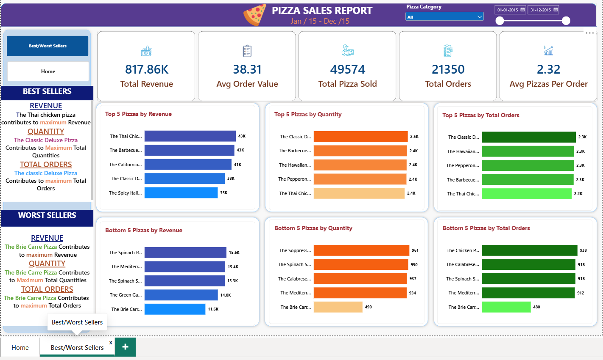

# 🍕 Pizza Sales Analysis – SQL & Power BI

## 📌 Project Overview
This project focuses on analyzing pizza sales data using SQL and Power BI to understand sales performance, customer ordering patterns, and product performance.

The objective is to transform raw sales data into meaningful business insights through SQL queries and an interactive Power BI dashboard.

## 🎯 Project Objectives
- Analyze total revenue and sales performance.
- Identify the most popular pizza categories and sizes.
- Analyze daily and monthly sales trends.
- Identify top-performing and low-performing pizzas.
- Build an interactive dashboard to support business decisions.

## 🛠️ Tools & Technologies
- **SQL:** Data analysis, filtering, aggregations, joins and subqueries.
- **Power BI:** Dashboard development and data visualization.
- **Power Query:** Data cleaning and transformation.
- **DAX:** Measures and KPI calculations.
- **CSV:** Dataset.

## 📂 Dataset
**File:** `pizza_sales.csv`

The dataset contains pizza sales transaction information used to analyze orders, quantities, revenue, pizza categories, sizes and product performance.

## 📊 Key Performance Indicators (KPIs)
- Total Revenue
- Total Orders
- Total Pizzas Sold
- Average Order Value
- Average Pizzas Per Order

## 📈 Dashboard Features
- Sales overview and KPI cards.
- Daily sales trend.
- Monthly sales trend.
- Sales by pizza category.
- Sales by pizza size.
- Top 5 best-selling pizzas.
- Bottom 5 least-selling pizzas.

## 🔍 SQL Analysis
SQL queries were used to:
- Calculate total revenue and total orders.
- Analyze sales by category and pizza size.
- Identify top 5 and bottom 5 pizzas.
- Analyze daily and monthly order trends.
- Calculate average order value and average pizzas per order.

## 📷 Dashboard Preview

### Main Dashboard


### Dashboard Home Page


## 📁 Project Structure
```text
Pizza-Sales-Analysis-SQL-Power-BI/
│
├── Dataset/
│   └── pizza_sales.csv
│
├── SQL Queries/
│   └── Pizza_Sales_Analysis.sql
│
├── PowerBI/
│   └── Pizza Sales Dashboard.pbix
│
├── Dashboard_Screenshots/
│   ├── Pizza Dashboard.png
│   └── Pizza_Dashboard Home.png
│
└── README.md
```

## 💡 Project Outcome
This project demonstrates practical skills in SQL querying, data analysis, data transformation, KPI calculations and Power BI dashboard development.

It helps understand sales trends and product performance through data-driven analysis.

## 👩‍💻 Author
**Trupti Lole**

MCS Graduate | Aspiring Data Analyst

Skills: SQL | Excel | Power BI 
